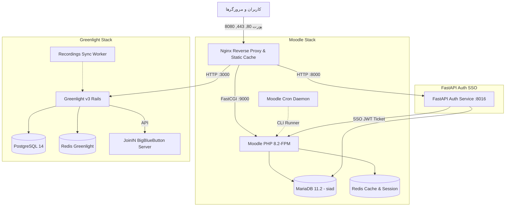

# سامانه یکپارچه آموزش الکترونیکی و وبینار (سیاد + گرین‌لایت ۳ + احراز هویت یکپارچه)

این مخزن شامل معماری جامع، ایزوله و پرسرعت برای راه‌اندازی **سامانه یادگیری مودل (Moodle 4.5 با PHP 8.2-FPM)**، **سامانه وبینار گرین‌لایت (Greenlight v3 با تم بومی هدی و اتصال JoinIN BigBlueButton)** و **سرویس احراز هویت یکپارچه (FastAPI Smart SSO & Auth)** به همراه سرور وب معکوس Nginx با بالاترین استاندارد کارایی است.

---

## ۱. ساختار و معماری سرویس‌ها



| سرویس | نام کانتینر | پورت داخلی | پورت پابلیش‌شده (هاست) | نقش و وظیفه |
| :--- | :--- | :--- | :--- | :--- |
| **Nginx** | `moodle_nginx` | 80, 443, 8080 | 80, 443, 8080 | دروازه ورودی، پروکسی معکوس، SSL و سرو مستقیم فایل‌های استاتیک |
| **Moodle PHP-FPM** | `moodle_fpm` | 9000 | - | هسته اجرای اسکریپت‌های PHP مودل (نسخه 8.2 بومی) |
| **Moodle Cron** | `moodle_cron` | - | - | اجرای تسک‌های پس‌زمینه مودل در حلقه ۶۰ ثانیه‌ای |
| **FastAPI Auth** | `moodle_fastapi_auth` | 8000 | 8016 | احراز هویت کد ملی، پیامک و صدور تیکت SSO مودل |
| **Greenlight App** | `gl-nginx-app` | 3000 | 3000 | وبینار و کلاس مجازی گرین‌لایت با تم هدی |
| **Greenlight Sync** | `gl-nginx-recordings-sync` | - | - | همگام‌ساز خودکار ضبط‌ها از بیگ‌بلو‌باتن |
| **MariaDB** | `moodle_mariadb` | 3306 | - | پایگاه داده اصلی مودل |
| **Redis** | `moodle_redis` | 6379 | - | نشست‌ها (Session) و کش مودل |
| **PostgreSQL** | `gl-nginx-postgres` | 5432 | - | پایگاه داده مستقل گرین‌لایت |
| **Redis GL** | `gl-nginx-redis` | 6379 | - | کش اختصاصی گرین‌لایت |

---

## ۲. پیش‌نیازهای سرور

- **سیستم‌عامل:** Ubuntu 22.04 / 24.04 یا Debian 12
- **سخت‌افزار پیشنهادی (برای بار همزمان تا ۱۰۰۰ کاربر):**
  - پردازنده: حداقل ۸ تا ۱۶ هسته
  - حافظه رم: حداقل ۱۶ تا ۳۲ گیگابایت
  - دیسک: حداقل ۱۰۰ گیگابایت فضای پرسرعت NVMe / SSD
- **نرم‌افزارها:**
  - `Docker` نسخه 24 به بالا
  - `Docker Compose` نسخه v2 به بالا
  - ابزارهای `git`, `curl`

---

## ۳. مراحل راه‌اندازی اولیه روی سرور (گام به گام)

### گام اول: دریافت کد پروژه
```bash
cd /opt
# یا مسیر دلخواه مانند /home/kali/development/elearnSetup/siad
git clone <آدرس_مخزن> siad
cd siad
```

### گام دوم: تنظیم متغیرهای محیطی (`.env`)

فایل‌های نمونه را بررسی و کپی کنید:

1. **فایل محیطی اصلی سیستم (`.env`):**
```bash
cp .env.example .env
```
در صورت نیاز مقادیر دامنه‌ها، رمزهای عبور دیتابیس و ردیس را در `.env` ویرایش کنید:
- برای سرور پروداکشن:
  ```env
  ENVIRONMENT=production
  MOODLE_HOST=siad.hu.jz.ac.ir
  MOODLE_URL=https://siad.hu.jz.ac.ir
  MOODLE_REVERSEPROXY=yes
  MOODLE_SSLPROXY=yes
  ```
- برای تست لوکال:
  ```env
  ENVIRONMENT=local
  MOODLE_HOST=localhost:8080
  MOODLE_URL=http://localhost:8080
  MOODLE_REVERSEPROXY=no
  MOODLE_SSLPROXY=no
  ```

2. **فایل محیطی گرین‌لایت (`greenlight/.env`):**
```bash
cp greenlight/.env.example greenlight/.env
```
مقادیر مربوط به BigBlueButton و هاست گرین‌لایت را تنظیم کنید:
```env
BIGBLUEBUTTON_ENDPOINT=https://api0.joinin.ir/jz-ac/api
BIGBLUEBUTTON_SECRET=<کلید_محرمانه_بیگ_بلو_باتن>
URL_HOST=sakoo.hu.jz.ac.ir
SAFE_DOMAIN=sakoo.hu.jz.ac.ir
```
*(برای تولید کلید تصادفی SECRET_KEY_BASE در گرین‌لایت می‌توانید از دستور `openssl rand -hex 64` استفاده کنید).*

3. **فایل محیطی سرویس احراز هویت (`fastapi_auth/.env`):**
```bash
cp fastapi_auth/.env.example fastapi_auth/.env
```

---

### گام سوم: تنظیم گواهی‌های SSL

پوشه `ssl/` باید شامل گواهی‌های دامنه باشد:
- `ssl/fullchain.pem`
- `ssl/privkey.pem`

اگر از Let's Encrypt یا Certbot استفاده می‌کنید، فایل‌های گواهی را در مسیر `ssl/` سیم‌لینک یا کپی نمایید. (برای تست موقت می‌توانید از اسکریپت `greenlight/scripts/bootstrap-selfsigned.sh` استفاده نمایید).

---

### گام چهارم: ساخت و اجرای سرویس‌ها

برای بیلد ایمیج‌های رسمی و اجرای کانتینرها دستور زیر را وارد کنید:

```bash
docker compose up -d --build
```

وضعیت اجرای کانتینرها را بررسی کنید:
```bash
docker compose ps
```
همه کانتینرها باید در وضعیت `Up` باشند.

---

### گام پنجم: بررسی سلامت دیتابیس و ارتقای مودل

از اجرای صحیح مودل و عدم نیاز به ارتقای ساختار دیتابیس اطمینان حاصل کنید:
```bash
docker exec -u www-data moodle_fpm php /var/www/html/admin/cli/upgrade.php --non-interactive
```

---

## ۴. راه‌اندازی کامل گرین‌لایت (Greenlight v3) با دسترسی ادمین

گرین‌لایت برای استفاده عملیاتی نیازمند ایجاد کاربر مدیر کل (Super Admin) و پیکربندی اولیه‌ی تنظیمات است.

### ۴.۱. ایجاد کاربر مدیر کل (Super Admin)

برای ایجاد حساب ادمین اصلی گرین‌لایت با دسترسی کامل، دستور زیر را در سرور اجرا کنید:

```bash
docker exec -it gl-nginx-app bundle exec rake admin:create
```

خروجی دستور، ایمیل و رمزعبور تصادفی تولیدشده را نمایش می‌دهد (مانند زیر):
```text
Account successfully created:
Email: admin@test.com
Password: Password123!
Role: Administrator
Please change your password after logging in.
```

> **نکته:** اگر می‌خواهید با ایمیل و رمز عبور دلخواه خود کاربر ادمین بسازید:
```bash
docker exec -it gl-nginx-app bundle exec rake "admin:create[نام ادمین,admin@yourdomain.ir,Password1234@,administrator]"
```

### ۴.۲. تنظیم روش ثبت‌نام (غیرفعال‌سازی ثبت‌نام عمومی - فقط دعوت یا ادمین)
به منظور جلوگیری از ثبت‌نام افراد متفرقه در سامانه کلاس‌ها:
```bash
docker exec -it gl-nginx-app bundle exec rails runner /usr/src/app/custom/set_registration_method.rb
```

### ۴.۳. تنظیم رنگ سازمانی (Primary Brand Color)
برای اعمال تم و رنگ سازمانی دلخواه:
```bash
docker exec -e BRAND_PRIMARY='#a628aa' -it gl-nginx-app bundle exec rails runner /usr/src/app/custom/set_brand_color.rb
```

### ۴.۴. تنظیم لوگوی سازمانی در تمام صفحات
برای ست کردن لوگوی دانشگاه در صفحات لاگین و سربرگ گرین‌لایت:
```bash
docker exec -e BRAND_IMAGE='/hoda-logo.png' -it gl-nginx-app bundle exec rails runner /usr/src/app/custom/set_brand_image.rb
```

### ۴.۵. مدیریت دسترسی و وضعیت پیش‌فرض ضبط‌ها (Recordings)
برای اینکه ویدیوهای ضبط‌شده به‌طور پیش‌فرض به صورت خصوصی/تاییدنشده باشند تا مدیر آن‌ها را تایید کند:
```bash
docker exec -it gl-nginx-app bundle exec rails runner /usr/src/app/custom/set_default_recording_visibility.rb
```

---

## ۵. دستورات کاربردی مدیریت مودل (Moodle CLI)

تمامی دستورات CLI مودل از طریق کانتینر `moodle_fpm` با کاربر `www-data` قابل اجرا هستند:

- **پاکسازی کامل کش‌های مودل (Purge Caches):**
  ```bash
  docker exec -u www-data moodle_fpm php /var/www/html/admin/cli/purge_caches.php
  ```

- **اجرای دستی تسک‌های زمان‌بندی‌شده کرون:**
  ```bash
  docker exec -u www-data moodle_fpm php /var/www/html/admin/cli/cron.php
  ```

- **بررسی و ریست رمز عبور کاربر مدیر مودل:**
  ```bash
  docker exec -u www-data moodle_fpm php /var/www/html/admin/cli/reset_password.php
  ```

- **فعال‌سازی وضعیت تعمیر و نگهداری (Maintenance Mode):**
  ```bash
  # فعال‌سازی:
  docker exec -u www-data moodle_fpm php /var/www/html/admin/cli/maintenance.php --enable
  # غیرفعال‌سازی:
  docker exec -u www-data moodle_fpm php /var/www/html/admin/cli/maintenance.php --disable
  ```

---

## ۶. تست و اعتبارسنجی سرویس‌ها

### ۱. تست مودل از طریق FastCGI و Nginx
```bash
curl -I http://localhost:8080/
```
باید کد `HTTP/1.1 200 OK` بازگردانده شود.

### ۲. تست ورود و صدور توکن سرویس FastAPI SSO
```bash
curl -s -X POST http://localhost:8016/api/login \
     -H "Content-Type: application/json" \
     -d '{"username":"admin1","password":"<رمز_عبور>"}'
```
پاسخ خروجی به شکل زیر همراه با لینک ریدایرکت حاوی تیکت SSO خواهد بود:
```json
{
  "success": true,
  "message": "ورود موفقیت‌آمیز بود.",
  "redirect_url": "http://localhost:8080/auth/sadaa/sso.php?ticket=..."
}
```

### ۳. تست گرین‌لایت
```bash
curl -I http://localhost:3000/
```

---

## ۷. مشاهده لاگ‌ها و عیب‌یابی (Troubleshooting)

- **مشاهده زنده لاگ کلیه سرویس‌ها:**
  ```bash
  docker compose logs -f
  ```
- **مشاهده لاگ مودل PHP-FPM:**
  ```bash
  docker compose logs -f moodle
  ```
- **مشاهده لاگ کرون مودل:**
  ```bash
  docker compose logs -f moodle-cron
  ```
- **مشاهده لاگ گرین‌لایت:**
  ```bash
  docker compose logs -f greenlight-v3
  ```
- **مشاهده لاگ انجین‌ایکس و درخواست‌های وب:**
  ```bash
  docker compose logs -f nginx
  ```

---

## ۸. نکات امنیتی و نگهداری پروداکشن

1. **فایل `config.php`:** این فایل در `.gitignore` قرار دارد و به‌صورت خودکار با متغیرهای محیطی سیستم تولید و همگام می‌شود. هرگز اطلاعات محرمانه دیتابیس را در فایل‌های مخزن کامیت نکنید.
2. **مجوزهای دایرکتوری Moodledata:** دایرکتوری داده‌های مودل در داخل کانتینر در `/var/moodledata` قرار دارد و با مجوزهای دسترسی کاربر استاندارد وب لینوکس (`www-data:www-data` یا 777) توسط `entrypoint.sh` مدیریت می‌شود.
3. **پشتیبان‌گیری منظم:**
   - پایگاه داده ماریا دی‌بی مودل:
     ```bash
     docker exec moodle_mariadb mariadb-dump -ualirezabb -pSEDO3482389D4 siad > backup_siad_$(date +%F).sql
     ```
   - پایگاه داده گرین‌لایت:
     ```bash
     docker exec -t gl-nginx-postgres pg_dump -U postgres greenlight-v3-production > backup_greenlight_$(date +%F).sql
     ```
   - دایرکتوری فایل‌های مودل (`moodledata` volume).
